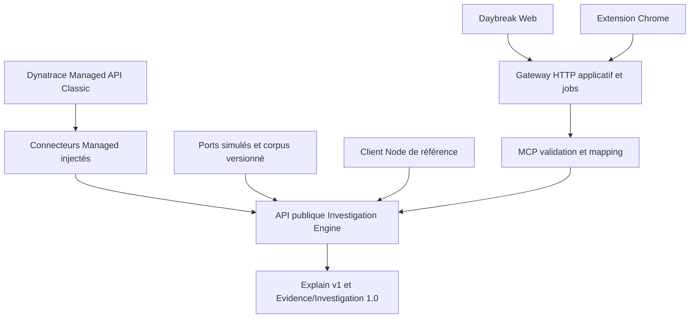

# Sprint 09 — Architecture réelle et indépendance

14 octobre 2026. Audit réalisé avant modifications ; sources des trois dépôts examinées. Références : rapports Sprint 08 lus intégralement, Sprint 05 et contrats Managed Explain, rapports/contrats UI Sprint 06 et 07, ADR 0001–0004. Managed exclusivement ; SaaS hors périmètre.

## Architecture avant

L'ADR 0001 avait déjà extrait des ports structurels et explainProblem. Le serveur MCP était déjà un consommateur via capabilities/problem-explain.ts et adapters/mcp/investigation-dependencies.ts. Le corpus Sprint 08 démontrait l'exécution directe dans Jest. Aucun import runtime Core → MCP SDK/Gateway/HTTP/Chrome n'a été trouvé. Le nom capabilities ne signifie pas que tous ses fichiers appartiennent à MCP : plusieurs sont des collecteurs et règles du moteur.

L'import public était un chemin interne explain.ts sans façade et type de rapport stable. Le collecteur importait statiquement local-investigation-model.ts, même lorsque model:null empêchait toute inférence. Les fixtures dépendaient de jest.fn. Le mapping MCP ne transmettait pas investigationLimits. Les sessions mémoire ne sont pas des sessions MCP, mais restent globales dans le processus.

## Matrice de cartographie préalable

| Composant                   | Responsabilité actuelle / modules                                           | Dépendances                                                | Couplage constaté / catégorie                                                      | Action recommandée et réalisée                                            |
| --------------------------- | --------------------------------------------------------------------------- | ---------------------------------------------------------- | ---------------------------------------------------------------------------------- | ------------------------------------------------------------------------- |
| Use case Explain            | core/investigation-engine/explain.ts                                        | Request, collecteur capabilities/problem-investigation     | Indépendance runtime déjà démontrée par corpus ; API peu exposée                   | Façade index, types et validation publique ; même use case                |
| Collecteur principal        | capabilities/problem-investigation.ts                                       | ports, provenance, métriques, evidence, Explain            | Aucun serveur ; sessions globales et import optionnel modèle réels                 | Import modèle différé ; sessions bornées conservées/documentées           |
| Collecte générale           | general-problem-evidence.ts, explain-service-evidence.ts                    | Reader borné et ports Managed                              | Interface abstraite acceptable                                                     | Conservée ; ERROR et SERVICE réutilisés                                   |
| Collecte disque/contexte    | problem-investigation.ts, published-problem-diagnosis.ts                    | Settings/Entities/Metrics/Logs par ports                   | Interface abstraite acceptable ; payloads legacy                                   | Pas de nouvelle collecte/remédiation                                      |
| SERVICE_SLOWDOWN            | service-slowdown.ts, metric-analysis.ts                                     | descripteurs, pairs, séries scoped                         | Indépendance déjà démontrée                                                        | Aucun deuxième moteur ni modification des règles                          |
| Approfondissement           | service-context.ts, service-enrichment.ts                                   | ports, limites, relations explicites, events               | Interface abstraite acceptable ; import type MetricCollection réciproque seulement | Pas de cycle runtime ; extraction physique facultative                    |
| Evidence/provenance         | provenance.ts, contracts/evidence et investigation                          | Zod, arguments réels des ports                             | Indépendant ; erreur générique collection_unavailable                              | Contrats inchangés ; validation intégrale supplémentaire                  |
| Explain/checks              | problem-explain-report.ts, explain-remediation.ts, explain-event-context.ts | preuves et règles déterministes                            | Indépendant ; noms historiques MCP dans commentaires/textes                        | Conservé ; validation des sections et références                          |
| Ports                       | dependencies.ts                                                             | types de query depuis capabilities/*-api, ExecutionProfile | Type-only, effacé runtime ; Map/any legacy acceptable                              | Types publics exportés ; normalisation plus stricte reportée              |
| Connecteurs réels           | authentication/managed-auth-client.ts, capabilities/*-api.ts                | config/token, HTTP/axios, logger                           | Couplage transport légitime dans connecteurs, absent du graphe runtime Core        | Injection par MCP ; aucune importation/création directe depuis Core       |
| Profil                      | core/execution-policy.ts, adapters/mcp/profiled-tools.ts                    | allowlist read-only et scope/token policy                  | Frontière d'autorisation interface                                                 | Profil existant préservé ; nouvel execute force incident-intelligence     |
| MCP                         | index.ts, tools/investigation-tools.ts, capabilities/problem-explain.ts     | serveur SDK, validation/mapping, Core                      | Déjà consommateur ; limites omises au mapping                                      | Façade publique et transmission limits ; mêmes paramètres/réponses/outils |
| Gateway                     | sre-morning-check/src/server.mjs et clients MCP                             | HTTP applicatif, sessions, jobs/persistance, policy        | Aucun import du Core ; orchestration MCP                                           | Aucun changement ; HTTP direct au Core futur                              |
| Daybreak Web                | public/workspace et présentation partagée                                   | Gateway HTTP, modèles UI                                   | Aucun collecteur/diagnostic                                                        | Aucun changement                                                          |
| Extension                   | sidepanel et investigation-model/view                                       | contexte URL Chrome, Gateway, DOM                          | Aucun Core/credential/Managed direct                                               | Aucun changement                                                          |
| Fixtures/client             | corpus Sprint 08, quality-managed.ts                                        | Jest avant ; ports fictifs                                 | Couplage du support de preuve réel                                                 | Ports sans Jest, client Node indépendant                                  |
| Package séparé / SDK / HTTP | Architecture cible                                                          | Packaging/auth/ACL à concevoir                             | Travaux à reporter, extraction physique facultative                                | Module public dans Engine ; aucun service/CLI produit ajouté              |

## Architecture après

Flèches d'appel/consommation pour les interfaces ; les collectes et leurs retours passent par les ports. Aucune interface ne possède le playbook. Façade publique → explainProblem → investigateManagedProblem → collectGeneralEvidence/collectExplainServiceEvidence → runServiceSlowdown → analyses/context/enrichment → buildExplainReport → attachInvestigationContract → validation du rapport. Les erreurs partielles conservent les preuves existantes.

Dépendance réellement retirée : import **statique runtime** du modèle optionnel depuis le collecteur. Le chargement différé demeure uniquement pour l'ancien chemin conversationnel général ; il est inatteignable par Explain (model:null, aucune question). Le client/simulation n'importe plus Jest. Aucun import SDK MCP n'était présent dans le graphe runtime initial : ne pas prétendre l'avoir supprimé. Types de paramètres issus des connecteurs et collecte dans capabilities restent des couplages physiques acceptables. Sessions mémoire globales, owner par défaut stdio et formes API Map/any restent documentés ; aucune durabilité ni isolation de stockage par instance revendiquée.

## Frontières et contrats

Core : collecte bornée, normalisation, comparaison, provenance, conclusions et vérifications conditionnelles. Connecteurs : accès Managed et credentials fournis par l'interface. MCP : validation des outils, profil/scopes, mapping et sérialisation de la même enveloppe. Gateway : API produit, accès/CSRF, orchestration, jobs/historique et renouvellement de sessions. Daybreak : contexte et rendu des rapports, aucune qualification diagnostique recalculée.

Voir [API publique](docs/core-public-api.md). executeInvestigation expose completed/partial/error sans changer le wire MCP. explainProblem conserve la signature et le rapport legacy ; MCP l'appelle depuis index.ts. Evidence/Investigation 1.0 et Explain v1 ne changent pas de version ou de champs. Les schémas supplémentaires vérifient les champs existants, préservent les extensions legacy et les références à la provenance originale.

## Exemple de bout en bout

Client S01 → alias prod/problemId quality-complete → ports versionnés renvoyant problème PERFORMANCE et service checkout → 13 lectures → descripteurs et six buckets par période → latence 100 à 300 ms, erreurs 1 à 1 %, volume 60 à 60 Count → 15 preuves avec sources GET et références résolues → completed, piste causale absente, vérification traces proposée, mechanism unknown/LLM disabled. Ces valeurs sont synthétiques. S08-budget conserve la paire latence après sept lectures puis retourne partial ; aucun refresh ou job réel.

## Actuel et cible

L'API directe et le consommateur fictif sont réellement implémentés. Les clients Daybreak utilisent encore Gateway → MCP → Core. Une HTTP API Engine directe, un SDK distribué et une CLI de production sont des interfaces futures, pas des composants livrés. Un package séparé ajouterait packaging, déclaration de types et distribution sans retirer de dépendance runtime supplémentaire démontrée ; le module public indépendant est proportionné pour cette étape. Il faudra réexaminer la mémoire/session, l'authentification et les ports de payload avant un pilote partagé.
